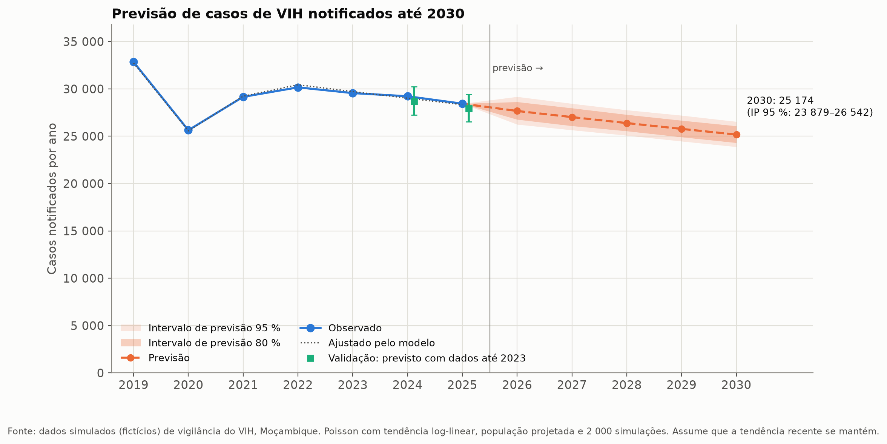
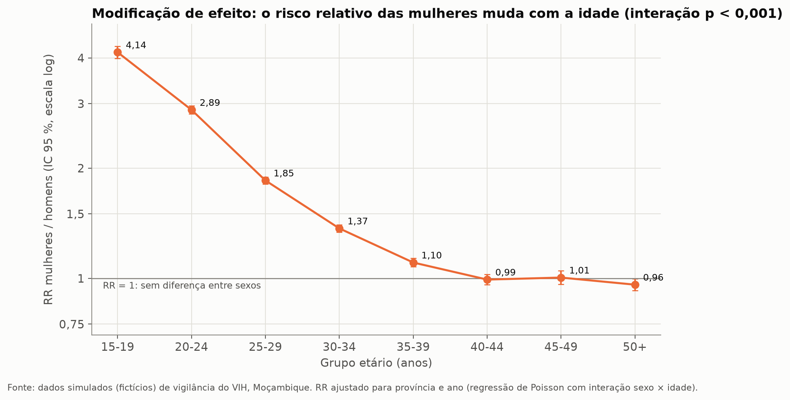
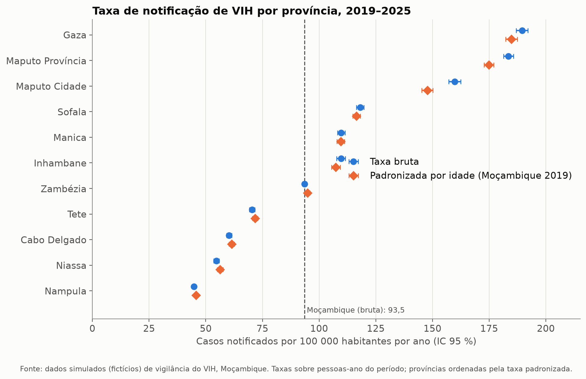

# Análise epidemiológica da vigilância do VIH em Moçambique (incl. PTV)

Pipeline completo em Python para analisar dados de vigilância do VIH, desde os dados brutos até ao relatório final:
limpeza, epidemiologia descritiva, taxas padronizadas, regressão de Poisson e logística, tendências e previsão até 2030.

> ⚠️ **Dados simulados.** O projeto usa dados **fictícios** gerados por `gerar_dados_simulados.py`.
> Os resultados servem para demonstrar e validar os métodos. Não representam a situação real de Moçambique.
> Os "valores verdadeiros" da simulação ficam guardados, por isso o código **verifica-se a si próprio**:
> a limpeza encontra os erros introduzidos e os modelos recuperam os parâmetros usados.



## O que o script faz

| Passo | Conteúdo | Métodos |
|---|---|---|
| 1. Configuração | Caminhos, parâmetros, registo (log) | `pathlib`, `logging` |
| 2. Limpeza | Duplicados, re-notificações, códigos, datas, valores impossíveis, completude | Registo de qualidade + verificação com o "gabarito" |
| 3. Descritiva | Pessoa, lugar e tempo; Tabela 1; cascata da PTV | Frequências, mediana [IIQ], curva epidémica |
| 4. Medidas | Taxas por 100 000, padronização por idade, indicadores com IC | Poisson exato, método direto + Fay & Feuer, Wilson |
| 5. Associação | Fatores associados à taxa de notificação e à doença avançada | Poisson com offset, interação sexo × idade, logística (OR bruto/ajustado) |
| 6. Tendências | Variação percentual anual, sazonalidade, previsão até 2030 | APC por Poisson, STL, simulação com população projetada, validação retrospetiva |
| 8. Geoespacial | Mapas coropléticos por província, mapas por ano, autocorrelação espacial | I de Moran global, LISA (contiguidade Queen) |
| 7. Relatório | Relatório HTML autónomo com todas as figuras e tabelas | — |

## Principais resultados (dados simulados)

- A taxa de notificação desceu cerca de **4,7 % por ano** nas pessoas com ≥ 15 anos (valor verdadeiro da simulação: −4,88 %).
- **Modificação de efeito:** raparigas de 15–19 anos têm uma taxa **4 vezes** superior à dos rapazes; a diferença desaparece depois dos 40 anos.
- **Confundimento:** a CPN parecia "proteger" contra a doença avançada (OR bruto 0,65), mas o efeito desaparece depois de ajustar para o sexo (OR ≈ 0,97).
- **Validação dos modelos:** 22 de 24 parâmetros verdadeiros dentro do IC 95 %.

<p float="left">
  
  
</p>

## Como correr

Requer Python 3.10 ou mais recente.

```bash
pip install -r requirements.txt
python gerar_dados_simulados.py      # cria dados/brutos/
python analise_vih_vigilancia.py     # corre os 8 passos (≈ 1 minuto)
```

O relatório final fica em `resultados/relatorio_vih_vigilancia.html`.

**Versão Jupyter:** abre `analise_vih_vigilancia.ipynb` (na pasta do projeto) e corre as células por ordem.
O notebook tem o mesmo código, dividido por passos, com explicações dos métodos (incluindo fórmulas) e a
interpretação dos resultados.

### Mapas (Passo 8, opcional)

1. Descarrega os limites das províncias: [geoBoundaries](https://www.geoboundaries.org) → *Mozambique* → *ADM1* → GeoJSON.
2. Guarda o ficheiro em `dados/mapas/` (qualquer nome terminado em `.geojson`, `.gpkg` ou `.shp`).
3. Corre de novo `python analise_vih_vigilancia.py`.

O script deteta a coluna com os nomes das províncias e corrige diferenças de grafia ("Zambezia", "Maputo City").
Sem o ficheiro, o Passo 8 é ignorado e o resto da análise corre normalmente.
Os limites do geoBoundaries (gbOpen) têm licença CC BY 4.0: mantém a atribuição nas figuras.

Para usar **dados reais**, coloca os ficheiros em `dados/brutos/` com os mesmos nomes e colunas
(`casos_vih.csv`, `ptv_mensal.csv`, `populacao.csv`) e ajusta os parâmetros no início do script (Passo 1).

## Estrutura

```
├── gerar_dados_simulados.py     dados fictícios + parâmetros verdadeiros + erros introduzidos
├── analise_vih_vigilancia.py    pipeline completo (Passos 1–8)
├── analise_vih_vigilancia.ipynb o mesmo pipeline em Jupyter, com explicações
├── requirements.txt
├── dados/                       (não versionado – é recriado pelo gerador)
│   ├── brutos/
│   ├── processados/
│   └── mapas/                   limites das províncias (descarregar – ver acima)
└── resultados/
    ├── figuras/                 03_* a 08_* (PNG)
    ├── tabelas/                 02_* a 08_* (CSV; 08_indicadores_provinciais.geojson abre no QGIS)
    └── relatorio_vih_vigilancia.html
```

## Limitações

- Casos notificados não são infeções novas: dependem da testagem e da completude da notificação.
- O CD4 falta em cerca de 40 % dos casos; a regressão logística usa casos completos.
- A previsão assume que a tendência recente continua.
- A transmissão vertical medida por PCR até aos 2 meses é a transmissão precoce.
- A análise espacial usa só 11 províncias: o I de Moran e o LISA têm pouco poder estatístico e são sobretudo descritivos.

## Autor

🐈‍⬛Luís Cuna 
<p>
  <a href="https://www.linkedin.com/in/luíscuna/"></a>
  <a href="https://orcid.org/0009-0008-6746-8544"></a>
  <a href="mailto:luiscuna.lc@gmail.com"></a>
</p>
